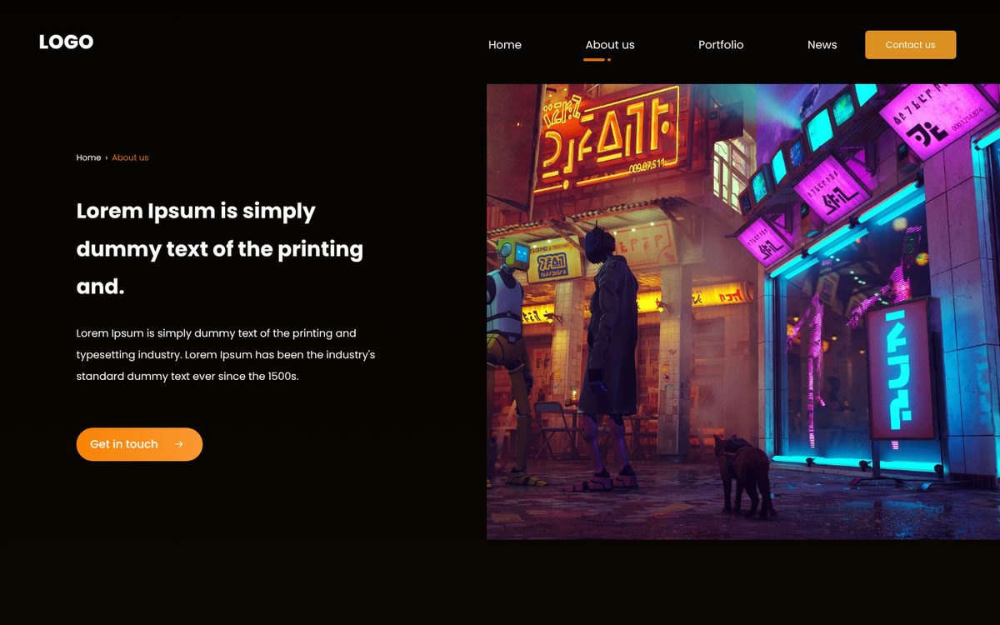

# Game Studio Website

A multi-page, responsive website for a fictional game development studio. I built it from a Figma mockup as a learning project to practice HTML, CSS and vanilla JavaScript.


## Pages

| Page | What is on it |
| --- | --- |
| **Home** (`index.html`) | Hero, trending games, banner, services, recent projects, newsletter form |
| **About us** (`about.html`) | Hero with an auto-rotating image showcase, "Why work with us" cards, story block, team |
| **Contact us** (`contact.html`) | Interactive world map of offices, contact details, "Say hello" form with validation |
| **News** (`news.html`) | Featured articles, article list and live search |

<p>
  
  
</p>
<p>
  
</p>

## Features

- Pixel-checked against the mockup at a 1440px viewport
- Interactive SVG world map: 18 office pins with pulse animation, popups with address / phone / directions, animated route arcs to HQ, city chips, keyboard and touch support
- Motion layer: scroll reveals with stagger, 3D card tilt, hover effects, count-up numbers, Ken Burns slider, scroll progress bar, back-to-top button, soft pointer spotlight, smooth page transitions (all disabled for `prefers-reduced-motion`)
- Responsive layout with breakpoints at 1024 / 768 / 480px and a burger menu
- Image showcase that changes slides every 5 seconds with a fade (pauses in a hidden tab, respects reduced-motion)
- Newsletter and contact forms with client-side validation and inline messages
- News search that filters articles as you type
- No frameworks, no build step

## Tech stack

HTML5, CSS3 (custom layout with Flexbox and Grid, no libraries), vanilla JavaScript, [Poppins](https://fonts.google.com/specimen/Poppins) font.

## Project structure

```
.
├── index.html
├── about.html
├── contact.html
├── news.html
├── css/        main.css, effects.css (animations) + one stylesheet per inner page
├── js/         main.js (menu, newsletter), effects.js (animations) + page scripts
├── img/        images and icons
└── screenshots/
```

## Run locally

No installation needed. Open `index.html` in a browser, or serve the folder:

```bash
python3 -m http.server 8000
# then open http://localhost:8000
```

## Notes

- Several images are placeholders and will be replaced with final artwork.
- Office locations, addresses and phone numbers on the map are fictional.
- The world map is generated from [Natural Earth](https://www.naturalearthdata.com/) data (public domain) via the `world-atlas` package.
- The forms do not send data anywhere; they only demonstrate validation.
