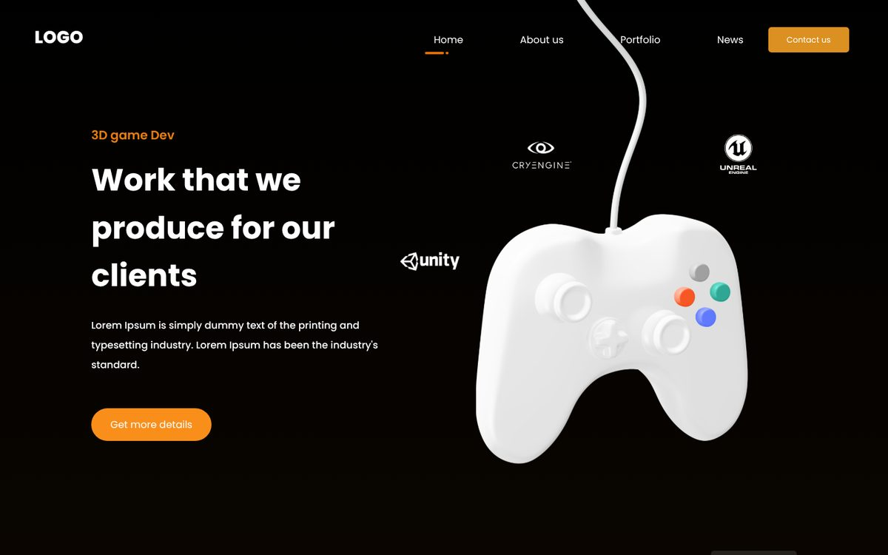
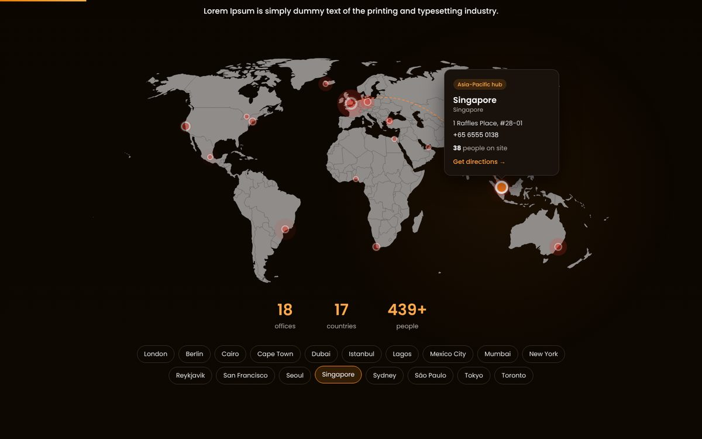

# Game Studio Website

A multi-page, responsive website for a fictional game development studio. I built it from a Figma mockup as a learning project to practice HTML, CSS and vanilla JavaScript.



## Pages

| Page | What is on it |
| --- | --- |
| **Home** (`index.html`) | Hero, trending games, banner, services, recent projects, newsletter form |
| **About us** (`about.html`) | Hero with an auto-rotating image showcase, "Why work with us" cards, story block, team |
| **Contact us** (`contact.html`) | Interactive world map of offices, contact details, "Say hello" form with validation |
| **News** (`news.html`) | Featured articles, article list and live search |

<p>
  
  
</p>
<p>
  
</p>

## Features

- Pixel-checked against the mockup at a 1440px viewport
- Interactive SVG world map: 18 office pins, popups with address / phone / directions, a route arc to HQ, city chips, keyboard and touch support
- Dark and light themes: switch in the header, choice is remembered, no flash on load (dark is the default)
- "Oops" dialog with an animated controller for links that do not lead anywhere yet, and a matching 404 page
- Game stickers (coin, trophy, gem, controller…) in the side margins. `js/stickers.js` measures the free space next to the content and hides a sticker when there is no room, so they never cover text. Edit the `LAYOUT` list at the top of the file to add or move them
- Calm, gaming-style motion: blocks fade in once as they enter the screen, headlines assemble from letters once (they never come apart), small hover feedback, one slow float on the 3D controller. Only `opacity` and `transform` are animated, with a single `IntersectionObserver` and no scroll listeners. Everything is disabled for `prefers-reduced-motion`
- Node.js + Express backend: contact form and newsletter are stored on the server, news search runs through the API, offices and stats are served as JSON
- Works without the backend too: on static hosting (GitHub Pages) the forms switch to an honest demo mode and search runs in the browser
- Fast: images are WebP, fonts load without blocking, below-the-fold images are lazy, responses are gzip-compressed. Lighthouse (local): Performance 99, SEO 100, Best practices 100, page weight about 375 KB
- SEO: canonical and Open Graph tags, share preview image, `sitemap.xml`, `robots.txt`
- Responsive layout with breakpoints at 1024 / 768 / 480px and a burger menu
- Image showcase that changes slides every 5 seconds with a fade (pauses in a hidden tab)

## Tech stack

HTML5, CSS3 (Flexbox and Grid, no libraries), vanilla JavaScript, Node.js 20+ with Express, [Poppins](https://fonts.google.com/specimen/Poppins) font.

## Architecture

```
data/*.json  ──►  scripts/build.mjs ──►  news.html, contact.html   (static markup, works anywhere)
     │
     └─────────►  server/ (Express API)  ◄──  js/api.js  ◄──  forms and search in the browser
```

- **One source of truth.** News and offices live in `data/news.json` and `data/offices.json`. To add an article or an office, edit the JSON and run `npm run build`; the pages and the API both pick it up.
- **Thin routes, logic in services.** `server/routes/api.js` only handles HTTP. Search and pagination are in `services/newsService.js`, storage is behind `services/store.js` (JSON Lines files today; swap that one file for a database later).
- **The server never trusts the browser.** Validation is repeated in `server/validation.js`, request bodies are limited to 10 kB, write endpoints are rate limited, only whitelisted files are served.
- **Progressive enhancement.** The pages are plain HTML. `js/api.js` talks to `/api`; if there is no backend it reports `offline` and each feature falls back.

### API

| Method | Route | Purpose |
| --- | --- | --- |
| GET | `/api/health` | Health check |
| GET | `/api/news?q=&page=&limit=` | Search and paginate articles |
| GET | `/api/news/:id` | One article |
| GET | `/api/offices` | Office list for the map |
| GET | `/api/stats` | Offices, countries, people |
| POST | `/api/contact` | Save a message (`firstName`, `lastName`, `email`, `message`) |
| POST | `/api/subscribe` | Subscribe an email |

Messages and subscribers are saved to `storage/*.jsonl` (ignored by git).

## Project structure

```
.
├── index.html, about.html, contact.html, news.html
├── 404.html, sitemap.xml, robots.txt
├── css/        main.css, effects.css, theme.css (light theme), oops.css, stickers.css + one stylesheet per inner page
├── js/         api.js, main.js, effects.js, theme.js, oops.js, stickers.js + page scripts
├── data/       news.json, offices.json
├── server/     app.js, index.js, config.js, routes/, services/, middleware/
├── scripts/    build.mjs (generates repeated HTML from data/)
├── test/       API tests (node:test)
├── img/        images and icons
└── screenshots/
```

## Run locally

With the backend (recommended):

```bash
npm install
npm start          # http://localhost:3000
npm run dev        # restarts on file changes
npm test           # API tests
npm run build      # regenerate news and map markup from data/*.json
```

Front end only: open `index.html` or run `python3 -m http.server 8000`. The forms then run in demo mode.

## Deploy

GitHub Pages hosts the static front end only (Settings → Pages → `main` / root). For the full version with the API, deploy the repo to any Node host (Render, Railway, Fly.io): the start command is `npm start` and the port comes from `PORT`.

## Notes

- The canonical URLs, `sitemap.xml` and share image use `https://user1234-code-maker.github.io/game-studio-site/`; change them if the site moves.
- Several images are placeholders and will be replaced with final artwork.
- Office locations, addresses and phone numbers on the map are fictional.
- The world map is generated from [Natural Earth](https://www.naturalearthdata.com/) data (public domain) via the `world-atlas` package.
