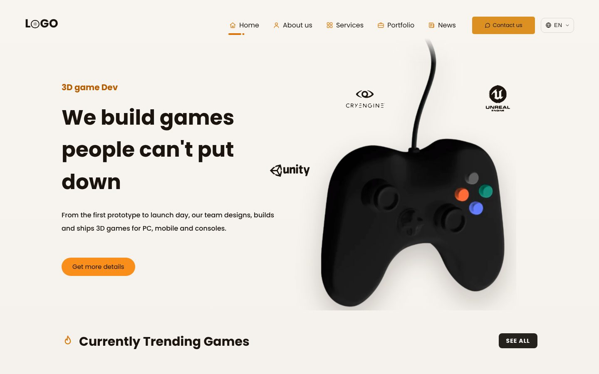

<div align="center">

# 🎮 Game Studio Website

**A multi-page, responsive website for a fictional game studio, with a real Node.js API, PostgreSQL and Stripe test payments.**

[](https://github.com/User1234-Code-maker/game-studio-site/actions/workflows/ci.yml)


[**Live demo (full stack)**](https://game-studio-site.onrender.com) · [Front end only (GitHub Pages)](https://user1234-code-maker.github.io/game-studio-site/) · [Security review](docs/security-review.md) · [Backend audit](docs/backend-audit.md)


</div>

It started as a hand-coded HTML/CSS/JS learning project built from a Figma mockup and grew into a full stack app: **React + TypeScript** on the front, **Express + PostgreSQL** on the back, and **Stripe Checkout** for ordering services.

## 📚 Contents

[Screenshots](#-screenshots) · [Pages](#-pages) · [Features](#-features) · [Tech stack](#-tech-stack) · [Run locally](#-run-locally) · [Tests](#-tests) · [Database](#-database-postgresql) · [Stripe](#-stripe-test-payments) · [API](#-api) · [Structure](#-project-structure) · [Deploy](#-deploy) · [Notes](#-notes)

## 🖼 Screenshots

<table>
  <tr>
    <td width="50%"><br><sub><b>Services</b>: what is included, deposit, order button</sub></td>
    <td width="50%"><br><sub><b>Order dialog</b>: deposit from the server, Stripe Checkout</sub></td>
  </tr>
  <tr>
    <td width="50%"><br><sub><b>Light theme</b>: the switch is the letter "O" of the logo</sub></td>
    <td width="50%"><br><sub><b>Contact</b>: interactive map with 18 offices</sub></td>
  </tr>
  <tr>
    <td width="50%"><br><sub><b>About us</b>: image showcase, story, team</sub></td>
    <td width="50%"><br><sub><b>News</b>: featured articles and live search</sub></td>
  </tr>
</table>

<p align="center"><br><sub>Mobile layout (390 px)</sub></p>

## 📄 Pages

| Page | What is on it |
| --- | --- |
| **Home** (`/`) | Hero, trending games, banner, services (each one can be ordered), recent projects, newsletter |
| **Services** (`/services`) | Six service cards (what is included, deposit from the server, order button), how an order works, FAQ, contact call-to-action |
| **About us** (`/about`) | Hero with an auto-rotating image showcase, "Why work with us", story, team |
| **Contact us** (`/contact`) | Interactive world map of offices, contact details, "Say hello" form |
| **News** (`/news`) | Featured articles, article list, live search |
| `/order/success`, `/order/cancel` | Where Stripe sends the customer back |

## ✨ Features

- **3D hero**: the gamepad is a real 3D model (`client/public/models/gamepad.glb`) rendered with three.js. It follows the cursor, presses its buttons, pauses when off screen, and falls back to the still picture without WebGL, on Save-Data or while loading. Rebuild the model with `npm run model --prefix client`; a model made in Blender can replace the `.glb`.
- React 19 + TypeScript (strict), Vite, React Router. Pixel-compared with the original static pages at 1440 / 820 / 390 px
- Three languages (English, Russian, Spanish) with `react-i18next` and JSON dictionaries (`client/src/i18n/locales/`). A test checks that all languages have the same keys and placeholders
- Dark and light themes. The theme switch is the letter "O" of the logo; the choice is remembered and applied before the first paint (no flash)
- Interactive SVG world map: 18 office pins, popups, route arc to HQ, city chips, keyboard and touch support
- Order a service: click a service, pay a project deposit in **Stripe Checkout (test mode)**
- Contact form, newsletter and orders are stored in **PostgreSQL** (JSON files as a zero-setup fallback for local work); honest demo mode on static hosting (no backend)
- Calm motion: fade-ins, headlines assembling from letters, 3D tilt on game cards, count-up numbers. Everything respects `prefers-reduced-motion`
- Accessible: axe-core reports 0 violations on every page in both themes; focus trap and Esc in dialogs, keyboard-operable language menu and map
- Security: strict CSP (no inline scripts), helmet, rate limiting, server-side validation and prices, signed Stripe webhooks that are checked against our own price list, owner-only data files. See [`docs/backend-audit.md`](docs/backend-audit.md) and [`docs/security-review.md`](docs/security-review.md) (findings, accepted risks, production checklist)
- Tested end to end: unit tests, security tests over real HTTP, and Playwright browser tests (smoke, user flows, the full payment cycle, XSS/CSP attacks, accessibility)

## 🧱 Tech stack

React 19, TypeScript, Vite, React Router, three.js, i18next, Vitest + Testing Library, ESLint, Prettier. Node.js 22, Express 5, PostgreSQL (`pg`), Stripe, helmet, `node:test`. Playwright + axe-core for browser tests.

## 🚀 Run locally

```bash
npm run setup        # installs the server and the client
npm run dev          # API on http://localhost:3000        (terminal 1)
npm run dev:client   # React app on http://localhost:5173  (terminal 2, proxies /api to :3000)
```

One server for everything (like production):

```bash
npm run build        # builds client/dist
npm start            # http://localhost:3000 serves the app and the API
```

## 🧪 Tests

```bash
npm test             # server tests (82; 95 with a real PostgreSQL, see below): API, payments, security, storage
npm run test:client  # front-end tests (44): components, validation, i18n parity
npm run lint         # ESLint
npm run audit        # npm audit for server and client
npm run e2e          # builds the client and runs the browser tests (Playwright, 63 scenarios)
npm run check        # everything above (except audit)
```

The first time, install the browser for the e2e tests: `npx playwright install chromium`.

What the layers cover:

| Layer | Where | What it proves |
| --- | --- | --- |
| Server unit/API | `test/api.test.js`, `test/payments.test.js` | Validation, duplicates, order status, webhook idempotency (Stripe is faked) |
| Storage | `test/store.contract.test.js`, `test/api.db.test.js` | The same behaviour on every back end (files, in-memory PostgreSQL, a real PostgreSQL server): one subscriber per address under 40 parallel requests, idempotent order events, SQL injection, database constraints, migrations, database outage |
| Server security | `test/security.test.js` | Headers and CSP, path traversal, hostile input, prototype pollution, error masking, log hygiene, file permissions, webhook forgery, wrong amounts, price tampering |
| Front end | `client/src/**/*.test.*` | Components, forms, news search, validation, translations have the same keys, redirect URL check |
| Browser smoke | `e2e/smoke.spec.js`, `e2e/layout.spec.js` | Every page loads with no console errors, CSP violations or broken images; real 404 status; no sideways scroll on mobile |
| Browser flows | `e2e/flows.spec.js` | Language and theme, newsletter, contact form, news search, services page (prices, FAQ, hover press effect), order dialog (focus trap, Esc, no gradients), full payment cycle with a signed webhook |
| Browser security | `e2e/security.spec.js` | CSP blocks injected scripts, XSS payloads in URL/search/forms/stored data, safe external links, no secrets or source maps in the build, rate limit |
| Accessibility | `e2e/a11y.spec.js` | axe-core (WCAG 2 A/AA) on every page in both themes |

The e2e server (`e2e/server.js`) is the real app with a fake Stripe client and an in-memory PostgreSQL, so the tests never touch the network or your data.

To also run the storage tests against a real PostgreSQL server, give the tests an admin connection (each test file creates and drops its own temporary database):

```bash
TEST_DATABASE_URL=postgres://postgres@localhost:5432/postgres npm test
```

CI (`.github/workflows/ci.yml`) runs all of it, plus `npm audit`, on every push and pull request; Dependabot opens weekly update PRs.

## 🐘 Database (PostgreSQL)

Messages, newsletter subscribers and Stripe order events live in three tables (`messages`, `subscribers`, `order_events`). The schema is in `server/db/migrations/*.sql`; the server applies new migrations on start (several instances starting together are safe), or run `npm run db:migrate`. Every query uses parameters, and the tables repeat the API's length and format rules as `CHECK` constraints, so bad data cannot get in even if the API is bypassed.

Without `DATABASE_URL` the server uses JSON files in `storage/` (handy for a quick start, not for production). The startup log says which one is active (`Storage: postgres`), and `GET /api/health` reports it and answers `503` if the database cannot be reached.

**Get a database**

- Local, with Homebrew: `brew install postgresql@17`, `brew services start postgresql@17`, `createdb studio`, then `DATABASE_URL=postgres://localhost:5432/studio` in `.env`.
- Or a free cloud database ([Neon](https://neon.tech), [Supabase](https://supabase.com)): copy its connection string into `DATABASE_URL` and set `DATABASE_SSL=true`.

Then `npm run start:env`. To move data saved earlier in `storage/*.jsonl`: `npm run db:import` (safe to repeat, existing rows are skipped).

## 💳 Stripe test payments

1. Create a free Stripe account and stay in **Test mode** (switch in the dashboard).
2. Dashboard → Developers → API keys → copy the **Secret key** (`sk_test_...`).
3. Copy `.env.example` to `.env` and set `STRIPE_SECRET_KEY=sk_test_...`.
4. Start with `npm run start:env` (or `npm run dev:env`) so the `.env` file is read.
5. Open the site, click a service, press the pay button. On the Stripe page use the test card `4242 4242 4242 4242`, any future date, any CVC.

The success page asks the server for the order status, and the server confirms it with Stripe, so it works even without a webhook. To also receive Stripe's webhook locally, install the [Stripe CLI](https://docs.stripe.com/stripe-cli) and run:

```bash
stripe listen --forward-to localhost:3000/api/stripe/webhook
```

Copy the printed `whsec_...` into `STRIPE_WEBHOOK_SECRET` and restart. Orders are stored in the `order_events` table (or `storage/orders.jsonl` without a database).

Live keys (`sk_live_...`) are refused unless `STRIPE_ALLOW_LIVE=true`.

## 🔌 API

| Method | Route | Purpose |
| --- | --- | --- |
| GET | `/api/health` | Health check |
| GET | `/api/news?q=&page=&limit=` | Search and paginate articles |
| GET | `/api/news/:id` | One article |
| GET | `/api/offices` | Office list for the map |
| GET | `/api/stats` | Offices, countries, people |
| POST | `/api/contact` | Save a message (`firstName`, `lastName`, `email`, `message`) |
| POST | `/api/subscribe` | Subscribe an email (same answer for new and known addresses) |
| GET | `/api/services` | Price list and whether payments are enabled |
| POST | `/api/checkout` | Start a Stripe Checkout session (`serviceId`, optional `email`, `locale`) |
| GET | `/api/orders/:sessionId` | Status of an order (`paid` / `pending` / `expired`) |
| POST | `/api/stripe/webhook` | Stripe events (signature verified) |

Errors are JSON `{ "error", "code", "details?" }` with stable codes; the front end translates them. API answers are sent with `Cache-Control: no-store`. A payment provider outage is reported as `502 payment_provider_error`.

## 🗂 Project structure

```
.
├── client/              React + TypeScript app (Vite)
│   ├── src/components/  Header, LanguageSwitcher, OfficeMap, ContactForm, OrderDialog, Modal, ...
│   ├── src/pages/       Home, About, Services, Contact, News, NotFound, OrderResult
│   ├── src/hooks/       useReveal, useInView, useCountUp, useNewsSearch, useErrorText, ...
│   ├── src/lib/         api client, validation, formatting, data, assets
│   ├── src/i18n/        i18next setup + locales/{en,ru,es}.json
│   ├── src/styles/      CSS (class-based, one file per area)
│   └── src/img/         images and icons (bundled and cached with hashed names)
├── data/                news.json, offices.json (used by the app and by the API)
├── server/              Express API: routes/, services/, middleware/, lib/, config.js
│   ├── db/              PostgreSQL pool, migrations/*.sql, migrate and import scripts
│   └── store/           storage interface: pgStore.js (PostgreSQL), fileStore.js (JSON files)
├── test/                API, payment and security tests (node:test)
├── e2e/                 Playwright browser tests + the fake-Stripe test server
├── docs/                backend-audit.md, security-review.md
├── design/              mockup and original photos
└── .github/             CI + GitHub Pages deploy, Dependabot
```

## 🚢 Deploy

- **GitHub Pages** (front end only, forms in demo mode, payments off): Settings → Pages → Source: **GitHub Actions**. The workflow in `.github/workflows/ci.yml` runs the tests and publishes `client/dist` with `VITE_BASE=/game-studio-site/` on every push to `main`. Unknown addresses are served by `404.html`, a copy of the app shell, so `/about` works on reload.
- **Full version with API and payments, free on Render.** `render.yaml` in the repository root describes the web service (build: `npm ci --omit=dev && npm ci --prefix client --include=dev && npm run build`, start: `npm start`, health check `/api/health`).
  1. Create a free database at [Neon](https://neon.tech) and copy its connection string (`postgresql://...`). Render's own free Postgres is deleted after 30 days, Neon's is not.
  2. On [Render](https://render.com): **New → Blueprint**, connect the GitHub repository. Render reads `render.yaml` and asks for four values: `DATABASE_URL` (the Neon string), `PUBLIC_URL` (`https://game-studio-site.onrender.com`, or whatever address Render shows), `STRIPE_SECRET_KEY` and `STRIPE_WEBHOOK_SECRET` (can be left empty first).
  3. In the Stripe dashboard create a webhook endpoint `https://<your-address>/api/stripe/webhook` for `checkout.session.completed`, `checkout.session.async_payment_succeeded` and `checkout.session.expired`, copy its signing secret (`whsec_...`) into `STRIPE_WEBHOOK_SECRET` on Render and redeploy.
  4. The free web service sleeps after 15 minutes without visitors and needs about a minute to wake up. Tables are created automatically on the first start.
- **Any other host** (Railway, Fly.io, a VPS): build command `npm run setup && npm run build`, start command `npm start`, same environment variables as in `render.yaml` (`NODE_ENV=production`, `PUBLIC_URL` with `https://` when Stripe is on, `TRUST_PROXY=1`, `DATABASE_URL`, `DATABASE_SSL`, Stripe keys). Go through the checklist in [`docs/security-review.md`](docs/security-review.md) before the first public deploy.

## 📝 Notes

- The canonical URL, `sitemap.xml` and share image use `https://user1234-code-maker.github.io/game-studio-site/`; change them if the site moves.
- Behind a reverse proxy set `TRUST_PROXY=1`; locally keep `0`, otherwise visitors could fake their IP and dodge the rate limit.
- Visitor data (e-mails, messages, orders) is personal data: add a privacy policy, decide how long you keep it, and back up the database. The JSON-file fallback is capped at 5 MB per file and readable by the server user only (`0600`).
- Office locations, addresses and phone numbers on the map are fictional. The world map comes from [Natural Earth](https://www.naturalearthdata.com/) (public domain).
- Prices in `server/services/catalog.js` are demo values in USD.
- A paid webhook is accepted only for sessions this site created, and only when the amount and currency match the price list.
- Unknown URLs get the app with a real `404` status when served by the Node server (on GitHub Pages `404.html` does the same job).
